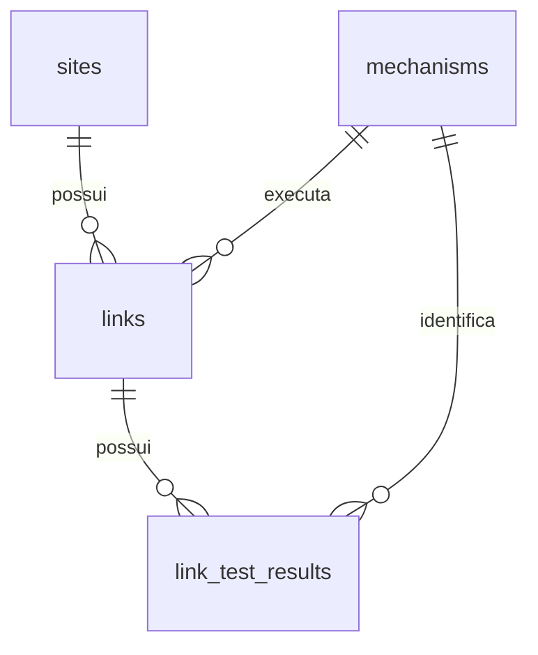

# Cadastro relacional e destino na base de Mídias

O destino definitivo deste cadastro é o banco de Mídias. Nesta entrega, somente o
SQLite local `var/gerenciador/catalogo.sqlite` é utilizado. Nenhuma conexão, tabela,
credencial ou dado do banco de Mídias é alterado.

## Entidades e cardinalidades

| Tabela | Responsabilidade | Relações |
|---|---|---|
| `sites` | Nome, endereço, país, idioma, observações, estado e exclusão lógica do site | Um site pode ter zero ou vários links |
| `links` | URL RSS/sitemap, tipo, seção, estado, evidência e mecanismo selecionado | Cada link pertence a exatamente um site e um mecanismo |
| `mechanisms` | Identificador estável do executor, parâmetros globais e revisão | Um mecanismo pode ser usado por vários links |
| `link_test_results` | Testes salvos, data, revisão, parâmetros usados e resultado | Cada resultado pertence a um link e identifica o mecanismo utilizado |
| `events` | Auditoria anterior/posterior das alterações | Mantém também registros excluídos e configurações antigas |
| `schema_migrations` | Versões das migrações locais aplicadas | Impede repetir transformações ou importações históricas |
| `metadata` | Origem da importação e relatórios operacionais do cadastro | Metadados; não substitui sites, links ou mecanismos |

As tabelas são reais, e não projeções de arquivos JSON/CSV. A tela lê e edita essas
tabelas por meio de `CatalogStore`. CSV e retratos só alimentam a primeira importação;
reiniciar a aplicação não os reaplica sobre cadastros editados.

Os nomes `source_id` e `model` foram mantidos para compatibilidade com o contrato atual:

- `sites.id`: chave primária numérica do site.
- `mechanisms.model`: chave primária textual estável (`auto`, `rss`, `sitemap`,
  `sitemap_tree`, `news_sitemap`), que identifica o arquivo executor.
- `links.source_id`: FK obrigatória para `sites.id`.
- `links.model`: FK obrigatória para `mechanisms.model`.
- `link_test_results.link_id`: FK obrigatória para `links.id`.
- `link_test_results.model`: FK obrigatória para `mechanisms.model`.

Não é permitido persistir link com site ou mecanismo inexistente, nem apagar
fisicamente um site/mecanismo referenciado. A URL é única dentro de cada site,
inclusive entre excluídos. Uma URL compartilhada entre marcas pode ter associações
distintas. Exclusão pela interface continua lógica e auditada. Inativar um site
suspende o uso de todos os seus links, preservando seus estados individuais.

O mecanismo compartilha a configuração global entre seus links. Não se cria uma
cópia do mecanismo por link. Os executores continuam nos módulos Python separados;
o banco guarda a escolha e seus parâmetros, sem armazenar código executável.

Parâmetros variáveis e instantâneos de provas/testes são JSON nas colunas de suas
tabelas. As identidades e os relacionamentos são normalizados com chaves estrangeiras.
`links.last_test` permanece como cache do último resultado para a API atual;
`link_test_results` preserva resultados salvos anteriores, com unicidade por link/teste.
Alterações de configuração ou exclusões lógicas não apagam esse histórico. Rascunhos
não salvos continuam temporários e não geram linhas sem vínculo com um link.

## Migração local aplicada

A migração transacional e idempotente renomeia:

| Antes | Agora |
|---|---|
| `sources` | `sites` |
| `endpoints` | `links` |
| `mechanism_settings` | `mechanisms` |

Em seguida, estabelece as FKs obrigatórias e cria `link_test_results`. A migração
preserva IDs, URLs, estados, exclusões, versões, provas, parâmetros e auditoria.
Resultados já presentes no cadastro e nos eventos locais são recuperados para a
tabela de testes, sem atribuir provas de um link copiado ao seu novo cadastro.
Uma falha de integridade desfaz a transação, incluindo renomeações.

Os identificadores e as rotas atuais da API foram preservados para manter o gerenciador
funcionando. Os arquivos brutos do mapeamento e da rodada 12 continuam preservados como
arquivos históricos; esta etapa não os importa integralmente para o cadastro relacional.

Implementação: `src/buscador_midias/catalog/schema.py` e `catalog/store.py`.

## Migração futura para Mídias — etapa obrigatória posterior

Este SQLite é o armazenamento provisório do mesmo modelo de domínio. A futura
migração não será apenas trocar a string de conexão: será necessário criar/adaptar
o repositório para o banco de Mídias e suas migrações nativas.

A etapa deverá:

1. Confirmar esquema, nomes físicos e eventuais tabelas existentes na base de Mídias.
2. Criar as entidades e FKs equivalentes, incluindo testes, auditoria e controle de versão.
3. Transportar dados em ordem: mecanismos, sites, links, testes e auditoria, mantendo
   IDs ou um mapa explícito de equivalência; incluir excluídos logicamente.
4. Converter tipos locais para os tipos do destino: datas UTC, booleanos e JSON.
5. Conferir contagens de todos os registros, IDs/vínculos, conteúdo dos parâmetros,
   resultados de testes e provas; ajustar sequências quando houver IDs importados.
6. Validar CRUD, ativação/exclusão lógica, conflitos de edição, configuração e testes
   com o repositório de Mídias antes da troca definitiva do gerenciador.
7. Fazer a troca controlada, preservando o backup local e definindo o ponto de corte
   para impedir duas bases divergentes recebendo alterações.

Não existe sincronização, escrita dupla ou migração remota nesta entrega.
