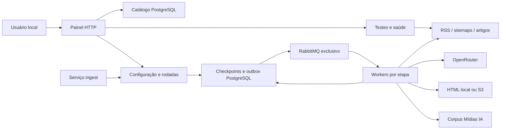

# Arquitetura atual

## Componentes e fronteiras

| Componente | Responsabilidade | Implementação principal |
|---|---|---|
| CLI | Entrada de comandos e carregamento de opções | [cli.py](../../src/buscador_midias/cli.py), [bm.sh](../../scripts/bm.sh) |
| Painel | HTTP local, páginas estáticas e JSON | [server.py](../../src/buscador_midias/dashboard/server.py), [catalog_api.py](../../src/buscador_midias/dashboard/catalog_api.py) |
| Catálogo | Sites, links, mecanismos, testes, revisões e auditoria | [store.py](../../src/buscador_midias/catalog/store.py), [postgres.py](../../src/buscador_midias/catalog/postgres.py) |
| Saúde | Verificação periódica de ativos e recuperação de falhas de acesso | [health_store.py](../../src/buscador_midias/catalog/health_store.py), [health_worker.py](../../src/buscador_midias/catalog/health_worker.py) |
| Painel de acompanhamento | Tela inicial: última rodada, histórico, falhas, saúde e auditoria, a partir de números pré-calculados por rodada | [panel.py](../../src/buscador_midias/ingestion/panel.py), [run_stats.py](../../src/buscador_midias/ingestion/run_stats.py), [panel.js](../../src/buscador_midias/dashboard/panel.js) |
| Ingestão | Agenda, rodadas, tarefas, filas, tentativas e recuperação | [store.py](../../src/buscador_midias/ingestion/store.py), [runtime.py](../../src/buscador_midias/ingestion/runtime.py) |
| Executores | Descoberta, deduplicação, texto, contexto, evidência e persistência | [engine.py](../../src/buscador_midias/ingestion/engine.py) |
| Contexto | Prompt, contrato da resposta, entidades, temas e categorias | [analysis](../../src/buscador_midias/analysis) |
| Corpus | Canonicalização, adaptação do artigo e escrita idempotente | [domain/url.py](../../src/buscador_midias/domain/url.py), [corpus](../../src/buscador_midias/corpus) |
| Evidência | Avaliação, captura, armazenamento e visualização | [evidence](../../src/buscador_midias/evidence), [evidence_view.py](../../src/buscador_midias/ingestion/evidence_view.py) |

O painel e o serviço de ingestão têm ciclos de vida independentes. As estatísticas por rodada que o Painel mostra são fechadas pelo agendador da ingestão; reiniciar o painel durante uma rodada de saúde a interrompe (ela é retomada). Fechar a aba não para o serviço. A saúde é iniciada pelo servidor do painel; fechar apenas a aba também não a para, mas encerrar o processo do painel encerra seu worker de saúde. O RabbitMQ não executa Python: entrega identificadores para os workers.

## Fluxo atual e fluxo legado

| Aspecto | Produto atual | Mapeamento/CLI anterior |
|---|---|---|
| Fontes de entrada | `sites` e `links` do catálogo | CSV, hints, estratégias e inventário estrutural |
| Entrada operacional | `dashboard` e `ingest serve` | `run`, `discover`, `enrich`, `corpus-sync`, `map-sites` |
| Estado | `midias_manager` e tabelas `ingest_*` | `midias_crawler_*` no esquema escolhido por `StateStore` |
| Orquestração | PostgreSQL + outbox + seis etapas RabbitMQ | Execução CLI e filas/checkpoints próprios do levantamento |
| Acesso | Transporte atribuído ao link; leitor direto sem consulta a robots | Pilha `net`/mapeamento com regras próprias, inclusive robots e fallback optativo |
| Agenda | Horários configurados do serviço de ingestão; a primeira rodada do dia pode cobrir o dia anterior | `install_cron.sh` chama o antigo `run` |

Os dois caminhos compartilham contratos de URL, extração, análise e corpus, mas não compartilham automaticamente a agenda ou as filas. Instalar o cron antigo não configura os quatro horários do buscador atual. Relatórios históricos e APIs antigas foram preservados; não são a fonte de verdade para o cadastro atual.

## Persistência e integração com PowerDD/KyX

O catálogo já foi migrado para PostgreSQL de Mídias. A aplicação gerenciadora continua em Python. O DDL deverá ser transportado para migrations do PowerDD preservando identificadores, FKs, revisões e histórico. O SQLite anterior é um retrato do corte, sem sincronização automática.

O corpus usa o contrato `midias_ia_*` existente, com canonicalização compatível com o KyX. Não é necessário criar uma diligência para inserir uma notícia. O RabbitMQ do buscador é separado do broker das diligências; a compatibilidade do corpus não significa que os consumidores PHP orquestrem esta ingestão.

## Limites da implementação

A leitura normal usa HTTP e parsing de documentos conhecidos. Ela não abre um navegador, executa JavaScript ou navega livremente por todas as páginas do site. Um sitemap index pode originar tarefas para filhos declarados, com deduplicação e limite de profundidade.

O acesso é público, com verificação TLS, validação de DNS/escopo e controle por host. HTTP 200 pode conter bloqueio, assinatura ou HTML sem artigo; por isso existe a avaliação textual. Os testes com navegador e transportes alternativos são ferramentas de diagnóstico, não uma promessa de superar qualquer bloqueio.

O painel é um MVP local, sem autenticação de usuários. Token e origem protegem as escritas do navegador local; não substituem controle de acesso para publicação na internet. O corpus guarda conteúdo e análise próprios, não uma cópia visual integral e autossuficiente de todos os recursos de cada página.

## Invariantes importantes

1. Site é pai de links; cada link seleciona um mecanismo e um transporte.
2. Revisões impedem aplicar um teste a uma configuração que mudou durante sua execução.
3. PostgreSQL guarda o estado; mensagens RabbitMQ carregam somente o identificador da tarefa.
4. Transição de etapa e outbox são gravadas na mesma transação.
5. Reentrega é esperada: checkpoints, gerações e unicidade protegem contra duplicação, sem prometer entrega exatamente uma vez.
6. Disponibilidade de uma amostra não equivale a cobertura de 100% da publicação.
