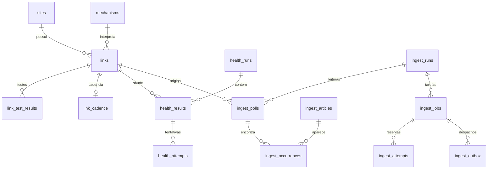

# Dicionário de dados e armazenamento

## Três famílias de dados

| Família | Local padrão | Função / responsável pelo esquema |
|---|---|---|
| Catálogo, saúde e ingestão atual | PostgreSQL de Mídias, esquema `midias_manager` | DDL Python do catálogo, saúde e ingestão |
| Corpus compartilhado | PostgreSQL de Mídias, tabelas `public.midias_ia_*` | Estrutura preexistente compatível com KyX/PowerDD; writer verifica contrato |
| Mapeamento e coleta antigos | Tabelas `midias_crawler_*`; esquema escolhido por `BUSCADOR_STATE_SCHEMA` ou padrão da conexão | DDL numerado em `sql/postgres` e `StateStore` |

Não é suficiente aplicar todos os arquivos de `sql/postgres` para criar o gerenciador atual. A migração do catálogo cria/importa seu esquema; saúde e ingestão fazem inicializações aditivas próprias. `PostgresCatalogStore.initialize` verifica o manifesto de importação e não cria silenciosamente um catálogo vazio.

## Relacionamentos principais

O diagrama resume relações; não enumera todas as FKs. `ingest_articles.article_id` é o vínculo lógico com o corpus e não uma FK declarada no DDL atual. `events.entity/entity_id` é uma referência polimórfica de auditoria, também não uma FK única para todos os tipos.

## Cadastro e auditoria

DDL: [postgres_schema.py](../../src/buscador_midias/catalog/postgres_schema.py).

| Tabela | Chave / conteúdo |
|---|---|
| `sites` | `id` BIGINT identity; `identity` único identifica host/caminho do cadastro; `name`, `url`, `country`, `language`, `notes`, `active`, `deleted_at`, `version`, datas, `origin` |
| `links` | `id` BIGINT identity; `source_id` FK para site; `url`, `kind=feed|sitemap`, `label`, `notes`, `active`, `deleted_at`, `version`, datas, `origin`, `model` FK, `access_transport`, `search_interval_seconds`, `evidence`, `last_test`; único `(source_id,url)` |
| `mechanisms` | `model` PK textual; `parameters` JSONB, `version` e `updated_at`; execução continua em código Python |
| `link_test_results` | Histórico salvo: link/mecanismo, `test_id`, revisão do modelo, parâmetros, observação e resultado; único `(link_id,test_id)` |
| `events` | Entidade, ID, ação, instante e JSONB anterior/posterior; inclui CRUD, configuração e restauração |
| `metadata` | Chave textual e valor JSONB de proveniência/metadados |
| `schema_migrations` | Versão e instante das migrações do catálogo |
| `catalog_imports` | Manifesto PostgreSQL: origem, instante, contagens e hashes da importação |

`active` do catálogo é SMALLINT com CHECK 0/1; o contrato de aplicação o apresenta como booleano. FKs de links/testes usam restrições que preservam histórico; exclusões do gerenciador são lógicas. Unicidade por site não impede sozinha que a mesma URL apareça em pais diferentes: consolidação editorial requer análise de identidade, não apenas igualdade do nome.

`last_test` é cache da prova atual, não substituto do histórico. `evidence` do link é a comprovação do caminho de busca, não o arquivo HTML de cada artigo do corpus.

| Campo | Unidade / interpretação |
|---|---|
| `search_interval_seconds` | Inteiro positivo; default 14400 = 240 minutos. A API usa segundos e o formulário converte unidades |
| `version` | Revisão otimista; não é número de acessos nem versão do software |
| `deleted_at` | Exclusão lógica; não equivale a uma falha HTTP recente |
| `origin` | Proveniência do cadastro/importação; não significa transporte da evidência |
| `parameters` | Configuração global do modelo; não contém código executável |
| `result` dos testes | JSONB com diagnóstico, amostras, métricas, revisões e configuração observada |

## Validação finita e cadência

| Tabela | Conteúdo |
|---|---|
| `catalog_validation_runs` | Rodada, estado, janela final, lookback, limite de tentativas, configurações congeladas e detalhe |
| `catalog_validation_links` | PK `(run_id,link_id)`; revisões de link/site, host, modelo inicial, estado, tentativas e instante de disponibilidade |
| `catalog_validation_attempts` | PK `(run_id,link_id,attempt)`; modelo, outcome, usable e resultado **BYTEA comprimido com zlib** |
| `link_cadence` | PK link; rodada de origem, estado, confiança, amostras, intervalo estimado em segundos, observação JSONB e data |

O `result` BYTEA dessa validação não é JSONB: descomprimir zlib antes de interpretar. Essa codificação difere de gzip usado nos planos/artefatos da ingestão. A validação é um processo finito separado da saúde e não deve ser reiniciada para consultar histórico.

## Saúde

DDL: [health_schema.py](../../src/buscador_midias/catalog/health_schema.py).

| Tabela | Conteúdo |
|---|---|
| `health_settings` | PK `kind=active|recovery`; habilitação, frequência em minutos, workers, tentativas, versão, próxima execução, Bright Data e opção de ativação |
| `health_runs` | ID textual; tipo, gatilho manual/agendado, estado, datas, heartbeat/dono, configuração congelada e total; índice impede duas abertas do mesmo tipo |
| `health_results` | PK rodada/link; site, host, snapshot, estado, categoria, tentativas, resultado/detalhe, datas e flag `activated` |
| `health_attempts` | PK rodada/link/tentativa; categoria, resultado JSONB e instante |
| `link_health` | Última observação por link, rodada, categoria, revisões de site/link/modelo e data |

Estados de rodada de saúde: `queued`, `running`, `cancelling`, `completed`, `cancelled`. Estados de item: `pending`, `running`, `completed`, `error`, `skipped`, `cancelled`. Categoria diagnóstica é outro campo; item `completed` pode conter `access_error`.

## Ingestão

DDL integral e estados: [ingestion/schema.py](../../src/buscador_midias/ingestion/schema.py).

| Tabela | Conteúdo / chave importante |
|---|---|
| `ingest_settings` | Linha `id=1`, versão, configuração JSONB e atualização |
| `ingest_runs` | ID da rodada; gatilho, estado, `since/until`, configuração e datas |
| `ingest_clock_runs` | Slot de horário PK; `run_id` único impede repetição do mesmo horário |
| `ingest_schedule` | PK link; `next_due`, último início/fim; agenda individual alternativa |
| `ingest_polls` | Leitura de link/rodada com snapshot e `discovery_done`; único rodada/link e índice impede duas descobertas abertas do mesmo link |
| `ingest_articles` | PK hash da URL; fonte/rodada/poll de referência, geração, estado, payload, ID lógico do corpus e datas |
| `ingest_occurrences` | PK poll/hash; todas as origens da URL, rodada e documento onde foi encontrada |
| `ingest_jobs` | ID, etapa, assunto, geração, rodada/poll/hash, estado, payload/result/outcome, attempts/failures, dispatch/owner, lease e datas; único etapa/assunto/geração |
| `ingest_attempts` | PK tarefa/tentativa; dono, início/fim, resultado, detalhe e métricas JSONB |
| `ingest_outbox` | Evento de publicação, tarefa, despacho, tipo, etapa, `host` (preenchido por gatilho a partir da URL, com índice `(etapa, host, disponibilidade, id)` para o publicador), disponibilidade, envio e eventual descarte; único tarefa/despacho |
| `ingest_workers` | Identificador do worker, papel, status, detalhe e heartbeat |
| `ingest_host_cooldowns` | Host e instante mínimo de novo acesso, inclusive `Retry-After` |
| `ingest_host_admission` | Última admissão por host, para alternância justa |
| `ingest_route_profiles` | PK fonte; regras temporais aprendidas e instante |
| `ingest_daily_routes` | PK link; `updates|archive|review`, motivo e atualização |
| `ingest_document_cache` | PK fonte/hash URL/revisão; hash do conteúdo, validadores HTTP, documento interpretado gzip/BYTEA e observação |
| `ingest_document_plans` | Plano de documento grande em JSON gzip/BYTEA, associado ao poll; eliminado após fechar a descoberta |
| `ingest_archives` | Esquema arquivado, prefixo de filas e manifesto; não reativa as tarefas antigas |

`attempts` conta reservas; `failures` conta falhas que consomem o limite. `dispatch` diferencia reenvios. `generation` separa reprocessamentos da mesma notícia. `lease_until` protege trabalho reservado por processo que pode morrer. Confundir esses campos pode fazer uma espera legítima parecer repetição sem limite.

O payload pode conter título, descrição, corpo transitório, publicação/base da data, análise, evidência e resultado de persistência. Depois de gravar ou descartar, o corpo pode ser removido desse payload; o corpus continua sendo o destino do texto definitivo. `snapshot` do poll preserva o cadastro utilizado, mesmo se o site for editado depois.

## Corpus compartilhado

Contrato verificado em [writer.py](../../src/buscador_midias/corpus/writer.py), transformação em [article.py](../../src/buscador_midias/corpus/article.py).

| Tabela | Dados utilizados |
|---|---|
| `midias_ia_articles` | URL/hash único; título, resumo, domínio/fonte; país e método; idioma/datas; description/body/body_source; categoria; origem; parecer/score/motivo/resumo/modelo IA; evidência path/status/tipo/tentativas; datas de criação/atualização |
| `midias_ia_article_entities` | Artigo, nome exato/normalizado, tipo, papel, contexto e extrator |
| `midias_ia_article_keywords` | Artigo, palavra/tema, categoria, campo e peso |
| `midias_ia_trusted_sources` | Cadastro ativo de fontes já existente no corpus; consulta de nomes/países por domínio e seção |

Inserção usa conflito por `url_hash`, sem duplicar artigo. Artigos de origem `crawler` têm política de atualização própria para evidência/entidades/temas; artigos de outra origem não são sobrescritos indiscriminadamente e só ganham evidência quando ainda não tinham captura. Uma transação por artigo limita o efeito de falhas.

Na ingestão atual, o fallback de país do writer consulta `midias_ia_trusted_sources`, com cache de cinco minutos; não lê diretamente `midias_manager.sites.country` para essa resolução. O snapshot guarda o cadastro do gerenciador, mas editar seu país não deve ser interpretado como sincronização automática do cadastro legado de fontes confiáveis.

`evidencia_tipo` guarda o formato, por exemplo `html`, **não o provedor**. A origem `direct`/`brightdata` fica nos registros de captura e no payload/histórico da ingestão (ou nas evidências do estado legado), não deve ser inferida apenas dessa coluna do corpus. Um transporte curl continua sendo captura HTTP direta; não equivale a usar Bright Data. O hash de integridade da evidência é o hash dos bytes salvos, diferente do hash canônico da URL.

## Arquivos persistidos

| Caminho / formato | Finalidade |
|---|---|
| `var/gerenciador/storage.json` | Seleção explícita do backend/esquema; variáveis de ambiente podem prevalecer |
| `var/gerenciador/catalogo.sqlite` | Base anterior ao corte; não é réplica atual do PostgreSQL |
| `var/ingestion/rabbit.env` | Configuração privada do broker/serviço; não publicar valores |
| `var/ingestion/work/*.html.gz` | HTML transitório entre extração e evidência; raiz substituível por `BM_INGEST_WORK_DIR` |
| `var/ingestion/evidence/midias-ia/evidencias/` | Evidência definitiva local da ingestão padrão |
| `var/ingestion/daily/evidence/midias-ia/evidencias/` | Evidências da instalação diária, conforme raiz de trabalho utilizada |
| `var/evidence/midias-ia/evidencias/` | Evidências do fluxo anterior; não confundir com os diretórios consultados pela rota atual do corpus |
| `var/gerenciador/*/` e `var/analise-rodada-12/` | Checkpoints, manifestos, relatórios e provas de auditorias específicas |
| `data/` | Catálogo CSV/hints/regras versionados; origem histórica, não substituto do catálogo editado |

Artefatos de trabalho usam gzip. Evidências HTML antigas também podem ter representação física `.html.gz`, mantendo a chave lógica `.html` no banco. O leitor prefere HTML bruto se existir e depois gzip, limita bytes descomprimidos e impede saída da raiz/symlinks externos. A compactação verifica integridade antes de retirar a representação bruta.

A captura adiciona `<base href>` para resolver recursos relativos. A evidência é o HTML salvo, não uma imagem de navegador, e pode depender de CSS/imagens externos para sua aparência. O visualizador bloqueia scripts e prepara estilos/estrutura para leitura; não recupera conteúdo que o servidor não enviou.

S3 é alternativa de armazenamento (`MIDIAS_IA_STORAGE_DISK=s3`, extra `s3`). Chaves permanecem `midias-ia/evidencias/...`; a compactação local não converte objetos S3. O leitor de evidências da ingestão resolve os diretórios padrão explicitamente; ao personalizar raízes, conferir também a rota de leitura.

## Migração futura e compatibilidade

Preservar IDs, unicidade, FKs, exclusões, revisões, eventos, codificações BYTEA e caminhos externos. Não transportar somente `sites/links` descartando testes e snapshots. [migrate_postgres.py](../../src/buscador_midias/catalog/migrate_postgres.py) confere contagens/hashes e sequências, sem sobrescrever silenciosamente destino já importado.

Os SQLs numerados 001–008 de `sql/postgres` pertencem majoritariamente ao estado legado; `009_link_access_transport.sql` acrescenta transporte ao catálogo atual. [sql/corpus/001_article_classification.sql](../../sql/corpus/001_article_classification.sql) acrescenta categoria/método de país ao corpus existente. `999_drop_midias_crawler_tables.sql` é rollback destrutivo do legado, não passo de instalação. A migração histórica de backlog em [daily_migration.py](../../src/buscador_midias/ingestion/daily_migration.py) exige workers e agenda pausados e preserva os dados em esquema de arquivo; não é rotina de limpeza de mensagens.

## Contextos por entidade e tema

Cada entidade citada gera linhas em `midias_ia_article_contexts` (produtor `buscador-midias`, sem
`process_id`/`client_id`/`group_id`, identidade só por nome). O front lista por `theme_id`, então
**toda entidade recebe os temas da notícia** (palavras-chave do artigo que existem no catálogo), uma
linha por tema e por variante nacional/estrangeira do tipo da entidade (ex.: Corrupção PF = 1 e 15,
PJ = 2 e 16). O `alerta`, a justificativa e o trecho continuam individuais; o `tema_confirmado`
fica nulo. O tema próprio que a IA aponta para uma entidade com alerta não substitui o da notícia.

- **Catálogo:** [theme_catalog.json](../../src/buscador_midias/corpus/theme_catalog.json), espelho da
  tabela `temas` do KyX (`person_type` 1 = PF nacional, 2 = PJ nacional, 3 = PF estrangeira,
  4 = PJ estrangeira). `processos_judiciais` fica de fora de propósito: os temas do KyX para ele são
  "Resumo", de outro risco. Mudou o catálogo do KyX, mude o arquivo e o teste do catálogo.
- **Sem tema do catálogo** (notícia neutra, só `diversos`): uma única linha sem `theme_id` por entidade.
- **Reprocessar** troca a linha sem tema deste escritor pelas temáticas; linhas de outro produtor ou
  com vínculo de processo/cliente/grupo nunca são apagadas nem sobrescritas.

