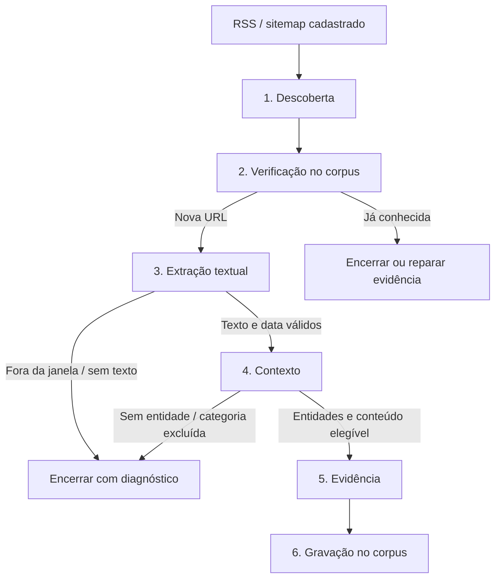

# Fluxo de busca de notícias

Fontes principais: [engine.py](../../src/buscador_midias/ingestion/engine.py), [store.py](../../src/buscador_midias/ingestion/store.py), [runtime.py](../../src/buscador_midias/ingestion/runtime.py), [flow.py](../../src/buscador_midias/ingestion/flow.py) e [schema.py](../../src/buscador_midias/ingestion/schema.py).

## Agenda, elegibilidade e janela

O padrão do código é `schedule_mode=clock`, horários **01h, 06h, 12h e 16h**, fuso `America/Sao_Paulo`. `enabled` habilita novas rodadas automáticas; `workers_enabled` controla o processamento. Uma rodada manual pode ser solicitada pelo painel. A configuração efetiva é a que está salva no banco.

Cada horário tem registro único em `ingest_clock_runs`. A tolerância é de 15 minutos; o serviço não repõe automaticamente todos os horários perdidos enquanto esteve desligado. No modo `clock`, os intervalos individuais dos links são ignorados. O modo alternativo `link_interval` usa `next_due` e o intervalo do cadastro, com seleção em lotes de até 500 links por passagem do agendador.

Entram sites e links ativos, não excluídos e sem outra leitura de descoberta aberta para o mesmo link. Com `daily_routes_only`, RSS, news sitemap e `g1_daily` são caminhos de atualizações; outros caminhos precisam ser classificados como `updates`. Rotas explicitamente `archive` ou `review` ficam fora desse modo. Informar IDs manualmente tem regras próprias no seletor; não implica reabrir um link já em leitura.

A rodada congela URL, site, mecanismo, parâmetros, transporte e revisões. A janela padrão vai da meia-noite civil até o instante da criação, não das últimas 24 horas nem até o fim futuro do dia. Uma execução às 01h busca o início do próprio dia. O campo manual `day` permite selecionar um dia dos últimos 30 dias; isso não implementa uma coleta histórica completa. Também existe janela `lookback` configurável.

**Fechamento do dia (`close_previous_day`, padrão desligado).** Com a janela "do dia", o que é publicado depois da última rodada nunca seria lido: uma notícia das 19h só poderia ser vista por uma rodada posterior a ela, e a seguinte (01h) já tem a janela do dia seguinte. Com a opção ligada, a **primeira** rodada de horário fixo do dia (a de menor horário; 01h no padrão) usa como início a meia-noite do dia **anterior**. Assim uma única rodada por dia cobre a noite que ficou descoberta e também dá uma retentativa às falhas da última rodada (ver "Nova tentativa de notícias que falharam"). A extensão vale só para rodada agendada em `window_mode=today`: rodada manual e o campo `day` não mudam. O custo é uma rodada diária com janela de dois dias (e menos corte pelo topo nela); as demais ficam iguais.

## As seis etapas

A etapa de contexto agora identifica entidades e avalia sua participação em lotes
de até quatro. Cada entidade identificada recebe parecer próprio, salvo em
`midias_ia_article_contexts` na transação de gravação do artigo. Respostas parciais
mantêm checkpoints e retomam somente as entidades faltantes. Na última tentativa do job
(`is_last_attempt`) o parcial validado é gravado: a rodada fica `partial`, a análise lista
as entidades sem parecer em `entity_context_missing` e o artigo não é perdido. Se nenhuma
entidade validou, o job segue falhando. Isso acrescenta chamadas de IA e custo, em série
por artigo (uma de análise mais uma por lote); não transfere o alerta geral para vítimas
ou autoridades. Veja
[contrato, limites e convivência com KyX/powerDD](../CONTEXTO_POR_ENTIDADE.md).

| Etapa / fila | O que faz | Resultado principal |
|---|---|---|
| `discovery` | Lê o documento do link, interpreta pelo mecanismo, seleciona filhos pertinentes e encontra URLs pertencentes ao site | Filhos e candidatos; sem novidades também é resultado válido |
| `dedup` | Calcula/consulta hashes compatíveis no corpus; processa lotes de até 500 tarefas | Conhecida encerra; nova segue para texto; conhecida com evidência faltante pode seguir para reparo |
| `fetch` | Acessa artigo com o transporte configurado, classifica a página e extrai título, texto, idioma e publicação | Texto confirmado segue; bloqueio, áudio dedicado, ausência de texto ou data/janela geram diagnóstico |
| `context` | Envia texto ao OpenRouter, valida JSON, entidades, temas, categoria e origem editorial | Análise válida ou erro explícito; resposta inválida não vira parecer negativo |
| `evidence` | Avalia e reaproveita o HTML salvo na extração, preservando origem e integridade | Evidência capturada ou pendência registrada |
| `persist` | Converte ao contrato do corpus, grava de modo idempotente e remove artefato temporário | ID real do artigo; estado `persisted` ou `evidence_pending` |

O hash identifica a URL canonicalizada, não o conteúdo textual. URLs de tracking colapsam pela regra compatível com PHP; hashes antigos de hosts `www1` etc. também são consultados. Não se trata de detectar automaticamente todo texto republicado em endereços diferentes.

## Descoberta sem expansão inútil

Cada documento XML é uma tarefa. Índices geram tarefas de filhos, sem executar toda a árvore dentro de um único worker. A profundidade padrão máxima é 10, respeitando o parâmetro do mecanismo. Documentos grandes são interpretados uma vez e divididos em continuações de até 500 candidatos e 64 filhos.

O cache guarda documento interpretado, hash, ETag e Last-Modified, isolado pelas revisões do cadastro. Requisições condicionais permitem resposta 304; o sistema reaplica a seleção temporal ao documento em cache. Isso reduz transferência/parsing, mas não dispensa a consulta de atualizações.

No `g1_daily`, o índice oficial fornece os arquivos diários; só os declarados e compatíveis com o calendário da janela/sobreposição são escolhidos. Em índices genéricos no modo diário, `lastmod` do filho ajuda a selecionar documentos; filhos sem data reconhecível são sinalizados como cobertura parcial, em vez de disparar varredura histórica cega. Perfis temporais aprendidos podem evitar arquivos antigos, com margem e registro da decisão.

A publicação explícita de RSS/News pode excluir uma URL fora da janela antes de baixar o artigo. `lastmod` de sitemap não vira data de publicação da notícia. Na extração, a data do HTML é preferida; publicação explícita do XML pode ser usada como pista. Sem data válida, o modo diário não aceita a notícia, mesmo com `allow_undated` ligado.

## Contexto, conteúdo e origem editorial

O padrão do código usa `openai/gpt-4.1-mini`, até 12.000 caracteres de texto por análise e o prompt versionado em [prompt.py](../../src/buscador_midias/analysis/prompt.py). Modelo e configurações ficam no snapshot da rodada; o resultado inclui versão do prompt usado.

O critério básico do corpus é análise baseada em texto e ao menos uma pessoa/organização identificável. Adversidade é uma classificação adicional: uma notícia sem fato adverso pode entrar. Nomes precisam aparecer no material fornecido. `finding=true` exige fato adverso e papel compatível de entidade nomeada; vítima ou autoridade, sozinha, não basta.

Categorias: `news`, `opinion`, `weather`, `cooking`, `sports`, `entertainment`, `lifestyle`, `horoscope`. Opinião tem precedência sobre o assunto quando o conteúdo é opinativo; isso não transforma a opinião em fato adverso. Temas de risco e categoria editorial são campos distintos.

**Detalhe da implementação atual:** `content_filter=off|shadow|enforce` controla as barreiras antecipadas por URL/título. Em `shadow`, essas pistas são registradas sem o descarte antecipado. A barreira após a IA chama `category_exclusion` independentemente desse modo: categoria configurada em `blocked_content_categories`, sem fato adverso e sem reparo de artigo existente, é descartada. Portanto, hoje `shadow` ou `off` não desliga sozinho a exclusão final por categoria. Essa diferença está registrada para evitar interpretar a opção como uma simulação integral do fluxo.

País editorial: região específica do idioma → país comprovado do artigo → país cadastrado da fonte. `en-US` é exceção: não decide o país pelo idioma. `pt`/`en` genéricos também não decidem. O país do acontecimento ou da pessoa citada não é a origem editorial. País e método são persistidos; valores desconhecidos permanecem nulos. O fallback de cadastro usado pelo writer atual vem de `midias_ia_trusted_sources`, não de uma sincronização automática do campo de país do gerenciador. Ver [country.py](../../src/buscador_midias/corpus/country.py) e [classificação](../CLASSIFICACAO_ARTIGOS.md).

## Filas, tentativas e retomada

Cada etapa tem fila normal, `.recovery` e `.failed`: **18 filas** para o prefixo padrão `midias.ingest`. Mensagens contêm `job_id`; os dados completos ficam no PostgreSQL. A outbox confirma a publicação antes de marcar o envio. Uma falha nesse intervalo pode gerar reentrega, tratada por reserva e estado da tarefa.

Workers usam `basic_get`, não consumidores permanentes `basic_consume`. Assim, `consumers=0` no RabbitMQ não prova que o serviço parou. Use os heartbeats do painel/banco e os logs. Há um worker dedicado de recuperação por etapa; workers principais também ajudam essa fila quando a fila normal está vazia. Aumentar a configuração acima dos slots criados na inicialização requer reiniciar o serviço.

Falhas comuns têm limite configurável de 1 a 3, espera exponencial baseada em `retry_minutes` e teto de uma hora para essa espera base. Erros permanentes podem encerrar antes. `Retry-After` pode impor espera maior. Adiamentos por host ocupado ou provedor temporariamente indisponível não consomem o contador de falhas comuns; por isso o número de reservas/tentativas pode ser maior que três sem significar três novas falhas HTTP. Indisponibilidade do provedor também pausa a etapa temporariamente.

Leases expirados são recuperados por `maintain`; cada reserva tem dono, geração e despacho. Uma tarefa finalizada ou substituída não deve ser executada novamente por uma mensagem atrasada. Reprocessamento manual é explícito; estar em `.failed` não cria um ciclo ilimitado de novas tentativas.

O serviço limita tarefas em trânsito e o backlog da etapa seguinte, além de serializar acesso por host real entre descoberta e extração. A reserva de disco de `flow.py` é **256 MiB**. Esses limites contêm produção, não representam um limite total de links da rodada. Mais workers não eliminam espera por um mesmo host, `Retry-After`, rede, PostgreSQL, disco ou OpenRouter.

## Nova tentativa de notícias que falharam

Dentro da rodada, a tarefa é repetida até `max_attempts` com espera exponencial; depois disso a notícia fica `failed`. Antes, uma rodada **posterior** que reencontrasse a mesma URL no feed não a admitia de novo: a descoberta só readmitia `outside_window` que entrou na janela, `date_unknown` e `cancelled`. Uma falha por tempo esgotado às 13h só seria vista outra vez se alguém reprocessasse à mão.

`failed_retry_limit` (1 a 5, padrão **1**, que desliga) é o número **total** de passadas por notícia: com 3, uma notícia é tentada na rodada original e até duas vezes em rodadas seguintes. Uma rodada que reencontra uma notícia `failed` a readmite (nova geração, nova tarefa de dedup) quando:

1. o artigo pertence a **outra** rodada (a mesma rodada nunca repete a própria falha, mesmo que dois feeds listem a URL);
2. `generation` ainda é menor que o limite;
3. nenhuma falha anterior dela é **permanente**.

São permanentes (`PERMANENT_FAILURE` em `flow.py`): HTTP 401, 402, 403, 404 e 410, `redirect_cycle`, destino fora dos domínios do site, `robots_unavailable` e erro de credencial do provedor pago. Por exemplo, um 403 de bloqueio não é repetido: ele costuma continuar, e cada tentativa extra aumenta a carga sobre o site; a saída é o acesso pago, não a repetição. Já "tempo esgotado", erro 5xx, conexão interrompida, "análise sem resposta válida" e "lote pendente" podem passar sozinhos e são repetidos.

Consequência para os horários 01h, 06h, 12h e 16h: a falha das 01h é retentada às 06h, 12h e 16h (até o limite); a falha das 16h é retentada na rodada das 01h seguinte, cuja janela inclui o dia anterior, mas só **uma** vez. A regra só age sobre notícias que continuam listadas no feed e dentro da janela da rodada; falhas anteriores à ativação não são reprocessadas sozinhas.

## Estados e interpretação do progresso

| Estado da tarefa | Significado |
|---|---|
| `pending` | Criada, aguardando publicação/admissão |
| `queued` | Publicada para execução |
| `running` | Reservada por worker, com lease |
| `retry` | Aguarda horário de nova tentativa/adiamento |
| `succeeded` | Etapa terminou; o resultado pode ser um descarte legítimo |
| `failed` | Falha terminal, disponível para diagnóstico/reprocessamento explícito |
| `skipped` / `cancelled` | Ignorada/cancelada pelo controle do processamento |

Estados de notícia como `known`, `outside_window`, `date_unknown`, `no_text`, `no_entities`, `excluded_content`, `persisted` e `evidence_pending` não são os mesmos estados da tarefa.

A rodada termina `completed` ou `partial`. A consolidação considera falhas, cobertura parcial, datas desconhecidas e evidência pendente. Por site, o cálculo tem regras próprias: pode incluir falha anterior de notícia compartilhada, mesmo sem falha local na tabela da rodada. A barra fica indeterminada enquanto a descoberta daquele site não termina; depois usa os links resolvidos e as cinco fases posteriores por notícia. **100% significa encerrado, não 100% de notícias gravadas nem cobertura integral do site.**

As notícias compartilhadas aparecem para suas fontes de origem, sem serem gravadas novamente por cada link. O detalhe por site permite abrir artigos reais do corpus e respectivas evidências. Referência do cálculo: [progress.py](../../src/buscador_midias/ingestion/progress.py).

## Acúmulo independente de evidências

A partir do ajuste de 26/10/2026, o backlog de `evidence` não pausa `context`.
As análises podem continuar e deixar suas evidências pendentes no PostgreSQL.
O publicador mantém somente um lote de até 32 mensagens de evidência prontas
no RabbitMQ; isso não limita o total pendente no banco. Não há descarte por
quantidade de evidências. Permanecem o controle das outras etapas, a reserva
de disco e os workers configurados. A rodada só encerra após resolver suas
tarefas; terminar a análise não significa que a evidência já foi capturada.

## Descoberta e verificação independentes

Descoberta e dedup não pausam por quantidade de verificações/downloads pendentes.
Esses metadados permanecem no PostgreSQL e são publicados gradualmente nas mesmas
filas. O limite de download aguardando contexto e o de evidência aguardando gravação
continuam em 200. A proteção de disco permanece ativa.

Dedup finaliza até 500 URLs numa operação SQL relacional, com checkpoint por tarefa
e outbox transacional. A análise existente só é carregada quando é necessário reparar
um artigo incompleto. O pool do serviço atende transações curtas; conexões que mantêm
locks durante HTTP são separadas. O cache HTTP de XML é curto e limitado, sem
compartilhar decisões de parsing ou escopo. Veja [implementação e medição](../PLANO_OTIMIZACAO_DESCOBERTA_CORPUS.md).

## Exclusão por `lastmod` antes do download

Uma página não é publicada depois da última modificação. Por isso, um `lastmod` anterior ao
início da janela prova que a publicação também foi anterior, e a URL pode ser descartada sem
baixar o artigo. O `lastmod` serve só para **excluir**: nunca vira data de publicação, e um
`lastmod` posterior à janela não diz nada sobre quando a matéria foi publicada.

Cautelas da regra (`lastmod_outside` em [flow.py](../../src/buscador_midias/ingestion/flow.py)):

- Data pura (meia-noite exata ou sem fuso) vale o dia inteiro, porque o dia pode terminar em
  outro fuso. Ex.: `2026-10-25` ainda pode ser 26/10 para um site do Pacífico.
- Soma-se uma folga de 12 h contra fuso mal rotulado (horário local marcado como `Z`).
- Publicação explícita (news sitemap, RSS) continua decidindo antes, pela regra antiga.

`lastmod_filter=off|shadow|enforce` (padrão `shadow`). Em `shadow` a URL segue o fluxo e a
descoberta registra `payload.shadow_lastmod_exclusion`, para comparar depois com a data real
extraída. Em `enforce` a descoberta nem cria as tarefas de dedup e fetch (métrica
`lastmod_excluded_urls`). Em rodadas já criadas, o subcomando
`scripts/bm.sh ingest backfill-lastmod [--apply]` aplica a mesma regra às tarefas abertas,
usando os XMLs em cache. Sem `--apply` apenas relata; com `--apply` recusa agir se alguma
notícia já confirmada dentro da janela teria sido excluída.

## Filtro pela forma da URL

`url_filter=off|shadow|enforce` (padrão `shadow`, como o `lastmod_filter`) decide só pela URL, na
descoberta, antes de criar as tarefas de dedup e fetch. Duas regras, ambas só para excluir:

- **Página de índice:** o **primeiro** segmento do caminho é `topic`, `topics`, `tag`, `tags`,
  `author`, `authors` ou `taxonomy` (`/author/ana`, `/topics/economia`). Só o primeiro segmento
  decide: `/native/negocios/topics/x/article/123` é notícia e não é barrada. No histórico, de
  19.267 URLs com esse primeiro segmento só 3 viraram artigo aceito.
- **Dia do caminho anterior à janela:** `/AAAA/MM/DD` no caminho, com o dia inteiro encerrado
  antes do início da janela no fuso da rodada (`timezone`). O dia do caminho é pista, nunca data
  de publicação. Dias iguais ou posteriores ao início da janela, datas impossíveis e URLs sem
  data nunca são excluídos. Não vale para URL com publicação explícita no XML (news sitemap,
  RSS), que continua decidindo pela regra antiga. Na checagem histórica de 3 dias, das URLs
  com caminho anterior à janela da própria rodada, 7.062 terminaram `outside_window` e 218
  (cerca de 3%) foram aceitas: esse é o custo conhecido da regra, aceito para não baixar
  milhares de notícias da véspera.

Em `shadow` a URL segue o fluxo e a descoberta registra `payload.shadow_url_exclusion`; em
`enforce` ela nem vira tarefa (métrica `url_excluded_urls`). Como a configuração da rodada é
congelada na criação, **rodadas já abertas não mudam de modo**: só a próxima rodada usa o valor
atual. O filtro age na descoberta; tarefas já criadas continuam seguindo o fluxo.

## Seleção de candidatos de rede por host

O publicador escolhe, a cada ciclo, a primeira tarefa pronta de cada host, alternando os hosts
pelo último horário de admissão. A coluna `ingest_outbox.host` é preenchida por gatilho na
inserção (qualquer caminho, inclusive o lote do dedup) e indexada junto com a etapa, de modo
que o custo cresce com o número de hosts e não com o tamanho da fila. Antes, cada ciclo
ordenava toda a fila pronta; com ~78 mil tarefas isso levava 2 a 3 s e deixava os workers de
`fetch` ociosos.

O ciclo do publicador também foi enxugado: a faxina de eventos obsoletos (que varre toda a
outbox não publicada, ~0,9 s com 33 mil linhas) roda no máximo a cada 30 s por publicador, o que
é seguro porque evento obsoleto nunca é publicado mesmo sem a faxina; e a lista de hosts com
trabalho novo, que o publicador de recuperação consulta segurando a trava global, deixou de
varrer e interpretar todas as linhas em Python (1.304 ms) para saltar de host em host pelo
índice `(stage, host)` (6 ms, mesmo resultado). Os dois custos pesavam em cada ciclo e
disputavam a trava com o publicador principal, o que espaçava os lotes do `fetch`.

`host_concurrency` (1 a 4, padrão 1) define quantas tarefas podem estar em trânsito no mesmo
host. A trava de execução usa vagas por host (`Engine.reserve_host`); com 1, o comportamento
é o anterior. Valores maiores aumentam a carga sobre cada site e só devem ser usados com
hosts que toleram.

`host_concurrency_max` (1 a 8, padrão 1, que desliga) concede vagas **extras só a hosts com fila
longa**: o limite do host é `min(host_concurrency_max, host_concurrency + fila_pronta ÷ 100)`
(`admission.host_limit`), recalculado a cada ciclo do publicador. Motivo: o fim de uma rodada
costuma ser dois ou três hosts grandes, com centenas de páginas cada, lidos uma por vez. Com 360
páginas na fila de um host e teto 3, ele passa a ter 3 em trânsito; um site com 20 páginas
continua com uma. O limite cai sozinho à medida que a fila esvazia. As travas do motor
(`Engine.reserve_host`) usam o maior limite possível (`Service.host_slot_ceiling`) e a admissão é
quem impõe o limite de cada host. Aumentar o número de workers de análise não encurta essa
cauda: a análise raramente é o gargalo (espera mediana de 1 s na fila, workers com folga).

## Corte pelo topo e parada antecipada

Muitos RSS e sitemaps listam do mais novo para o mais antigo. Se a entrada do topo já é anterior ao início da janela, o documento inteiro está fora dela, e baixar e interpretar o resto é desperdício. `head_filter` (`off`, `shadow` ou `enforce`; padrão `shadow`) aplica essa regra:

- **Ordem de leitura do link** (`links.read_order`: `newest_first`, `oldest_first`, `unordered`, `unknown`), medida uma vez e gravada. Só vira `newest_first` quando o documento inteiro a confirma: todas as entradas datadas, pelo menos 8, em ordem (tolerância de 1 minuto) e com o topo sendo de fato o mais recente. Qualquer dúvida vira `unordered`/`unknown`, que mantém a leitura completa; errar para esse lado só custa tempo. Ver [Catálogo](CATALOGO_MECANISMOS.md).
- **`shadow`**: lê tudo e só registra o que teria cortado (`head_shadow_would_skip`) e se teria perdido URL da janela (`head_shadow_missed`).
- **`enforce`**: com o topo fora da janela, devolve `sem_novidades` sem processar o documento. Leitores que sabem parar (direto e curl; não Bright Data nem leitura em lote) interrompem o **download** nos degraus de 32 KiB, 128 KiB, 512 KiB e 2 MiB quando o prefixo, fechado na última entrada completa, tem pelo menos 3 datas em ordem decrescente e todas fora da janela. Arquivos `.gz` e `.zip` não usam parada antecipada.
- **Conferência a cada leitura**: a ordem registrada nunca é só presumida. Se o documento contradiz o rótulo, a leitura segue completa, a métrica `read_order_contradicted` conta o caso e o link é rebaixado para a ordem observada. Exemplo: um feed com uma matéria fixada de ontem no topo e notícias de hoje abaixo é detectado como fora de ordem e nunca é cortado.

Em produção, cerca de 4 em cada 10 leituras de descoberta são cortadas por esta regra, boa parte pelo download interrompido.

## Auditoria do corte pelo topo

Com `enforce` não há como saber, olhando só o resultado, se algum corte perdeu notícia. `head_audit_rate` (0 a 1; padrão 0; **0,02** em produção) escolhe uma fração dos links, por sorteio determinístico de rodada e link (`flow.audit_sampled`; um reinício ou retentativa não troca a amostra), que **lê o documento inteiro em modo sombra** mesmo com o corte ativo. Nessas leituras são gravados `head_audit_sampled`, `head_shadow_would_skip` (o corte teria atuado) e `head_shadow_missed` (e teria perdido URL da janela). O caminho do download interrompido também é auditado: verifica se o prefixo teria disparado a parada em algum degrau. A perda estimada é `missed ÷ would_skip` da amostra.

`scripts/head_filter_report.py [--run-id ID]` resume uma rodada. O Painel mostra a prova da janela escolhida, contando só rodadas com `head_filter=enforce`: em modo sombra os "cortes" são simulações de uma fase anterior das regras, e somá-los faria um erro já corrigido aparecer como perda de hoje.

## Leitura adaptativa dos links frios

A maioria dos links nunca traz notícia nova: em seis rodadas seguidas, 85% dos links lidos não gravaram nada. `adaptive_polling` (`off` ou `enforce`; padrão `off`) lê esses links menos.

Um link é **frio** quando suas últimas 4 leituras (dos últimos 7 dias) não trouxeram nenhuma URL candidata e nenhuma descoberta falhou (link com falha continua sendo lido para poder se recuperar). A evidência é por leitura **do link**, não por rodada: se fosse "últimas rodadas", um link lido só duas vezes por dia deixaria de parecer frio e voltaria a ser lido sempre.

Rodadas de horário fixo que não são de ponta pulam os links frios: com 01h, 06h, 12h e 16h, eles são lidos às 01h e às 16h. Isso não perde notícia **desde que** `close_previous_day` esteja ligado, porque a janela da rodada das 16h cobre 00h–16h e a das 01h cobre o dia anterior inteiro mais a primeira hora do dia: todo instante fica dentro de alguma leitura do link, só a entrega pode atrasar. Rodada manual e lista explícita de links leem tudo, todo link continua sendo lido todos os dias, e a rodada registra em `config.adaptive_skipped` quantos pulou.

## Resposta vazia do OpenRouter

Uma resposta HTTP 200 sem `choices` (o provedor de origem falhou e o OpenRouter devolveu um
objeto de erro) agora é repetida pelo cliente, com a mesma espera exponencial das falhas 429/5xx,
antes de virar falha. Só depois de esgotar as tentativas o erro "resposta sem conteúdo" chega ao
motor, que registra a falha no disjuntor do serviço (`ProviderBreaker`, em `flow.py`). Em 24 h de
26/10 houve 40 pausas de 5 minutos por um único erro, que paravam o contexto e, por contenção de
backlog, o `fetch`. Hoje uma falha isolada só adia o próprio job por 60 s; a etapa só pausa por
60 s quando há 5 falhas do provedor em 60 s, somadas entre todos os workers dela, e a contagem
recomeça do zero depois da pausa. Falhas de jobs que já estavam em andamento durante a pausa não a
prolongam. Uma queda real do OpenRouter ainda paralisa a etapa em segundos; um erro transitório não.

