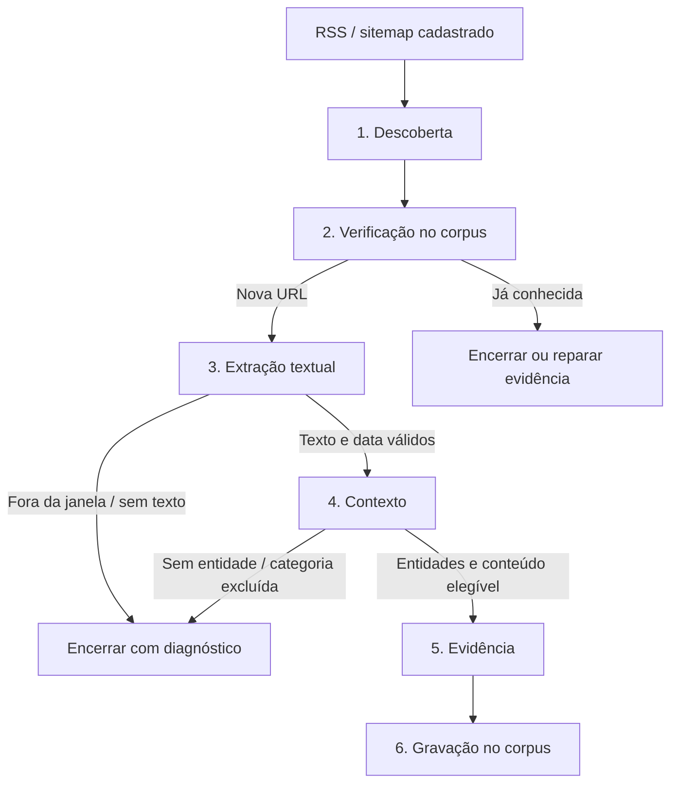

# Fluxo de busca de notícias

Fontes principais: [engine.py](../../src/buscador_midias/ingestion/engine.py), [store.py](../../src/buscador_midias/ingestion/store.py), [runtime.py](../../src/buscador_midias/ingestion/runtime.py), [flow.py](../../src/buscador_midias/ingestion/flow.py) e [schema.py](../../src/buscador_midias/ingestion/schema.py).

## Agenda, elegibilidade e janela

O padrão do código é `schedule_mode=clock`, horários **01h, 06h, 12h e 16h**, fuso `America/Sao_Paulo`. `enabled` habilita novas rodadas automáticas; `workers_enabled` controla o processamento. Uma rodada manual pode ser solicitada pelo painel. A configuração efetiva é a que está salva no banco.

Cada horário tem registro único em `ingest_clock_runs`. A tolerância é de 15 minutos; o serviço não repõe automaticamente todos os horários perdidos enquanto esteve desligado. No modo `clock`, os intervalos individuais dos links são ignorados. O modo alternativo `link_interval` usa `next_due` e o intervalo do cadastro, com seleção em lotes de até 500 links por passagem do agendador.

Entram sites e links ativos, não excluídos e sem outra leitura de descoberta aberta para o mesmo link. Com `daily_routes_only`, RSS, news sitemap e `g1_daily` são caminhos de atualizações; outros caminhos precisam ser classificados como `updates`. Rotas explicitamente `archive` ou `review` ficam fora desse modo. Informar IDs manualmente tem regras próprias no seletor; não implica reabrir um link já em leitura.

A rodada congela URL, site, mecanismo, parâmetros, transporte e revisões. A janela padrão vai da meia-noite civil até o instante da criação, não das últimas 24 horas nem até o fim futuro do dia. Uma execução às 01h busca o início do próprio dia. O campo manual `day` permite selecionar um dia dos últimos 30 dias; isso não implementa uma coleta histórica completa. Também existe janela `lookback` configurável.

## As seis etapas

| Etapa / fila | O que faz | Resultado principal |
|---|---|---|
| `discovery` | Lê o documento do link, interpreta pelo mecanismo, seleciona filhos pertinentes e encontra URLs pertencentes ao site | Filhos e candidatos; sem novidades também é resultado válido |
| `dedup` | Calcula/consulta hashes compatíveis no corpus; processa lotes de até 100 tarefas | Conhecida encerra; nova segue para texto; conhecida com evidência faltante pode seguir para reparo |
| `fetch` | Acessa artigo com o transporte configurado, classifica a página e extrai título, texto, idioma e publicação | Texto confirmado segue; bloqueio, áudio dedicado, ausência de texto ou data/janela geram diagnóstico |
| `context` | Envia texto ao OpenRouter, valida JSON, entidades, temas, categoria e origem editorial | Análise válida ou erro explícito; resposta inválida não vira parecer negativo |
| `evidence` | Avalia e reaproveita o HTML salvo na extração, preservando origem e integridade | Evidência capturada ou pendência registrada |
| `persist` | Converte ao contrato do corpus, grava de modo idempotente e remove artefato temporário | ID real do artigo; estado `persisted` ou `evidence_pending` |

O hash identifica a URL canonicalizada, não o conteúdo textual. URLs de tracking colapsam pela regra compatível com PHP; hashes antigos de hosts `www1` etc. também são consultados. Não se trata de detectar automaticamente todo texto republicado em endereços diferentes.

## Descoberta sem expansão inútil

Cada documento XML é uma tarefa. Índices geram tarefas de filhos, sem executar toda a árvore dentro de um único worker. A profundidade padrão máxima é 10, respeitando o parâmetro do mecanismo. Documentos grandes são interpretados uma vez e divididos em continuações de até 500 candidatos e 64 filhos.

O cache guarda documento interpretado, hash, ETag e Last-Modified, isolado pelas revisões do cadastro. Requisições condicionais permitem resposta 304; o sistema reaplica a seleção temporal ao documento em cache. Isso reduz transferência/parsing, mas não dispensa a consulta de atualizações.

No `g1_daily`, o índice oficial fornece os arquivos diários; só os declarados e compatíveis com o calendário da janela/sobreposição são escolhidos. Em índices genéricos no modo diário, `lastmod` do filho ajuda a selecionar documentos; filhos sem data reconhecível são sinalizados como cobertura parcial, em vez de disparar varredura histórica cega. Perfis temporais aprendidos podem evitar arquivos antigos, com margem e registro da decisão.

A publicação explícita de RSS/News pode excluir uma URL fora da janela antes de baixar o artigo. `lastmod` de sitemap não vira data de publicação da notícia. Na extração, a data do HTML é preferida; publicação explícita do XML pode ser usada como pista. Sem data válida, o modo diário não aceita a notícia, mesmo com `allow_undated` ligado.

## Contexto, conteúdo e origem editorial

O padrão do código usa `openai/gpt-4.1-mini`, até 12.000 caracteres de texto por análise e o prompt versionado em [prompt.py](../../src/buscador_midias/analysis/prompt.py). Modelo e configurações ficam no snapshot da rodada; o resultado inclui versão do prompt usado.

O critério básico do corpus é análise baseada em texto e ao menos uma pessoa/organização identificável. Adversidade é uma classificação adicional: uma notícia sem fato adverso pode entrar. Nomes precisam aparecer no material fornecido. `finding=true` exige fato adverso e papel compatível de entidade nomeada; vítima ou autoridade, sozinha, não basta.

Categorias: `news`, `opinion`, `weather`, `cooking`, `sports`, `entertainment`, `lifestyle`, `horoscope`. Opinião tem precedência sobre o assunto quando o conteúdo é opinativo; isso não transforma a opinião em fato adverso. Temas de risco e categoria editorial são campos distintos.

**Detalhe da implementação atual:** `content_filter=off|shadow|enforce` controla as barreiras antecipadas por URL/título. Em `shadow`, essas pistas são registradas sem o descarte antecipado. A barreira após a IA chama `category_exclusion` independentemente desse modo: categoria configurada em `blocked_content_categories`, sem fato adverso e sem reparo de artigo existente, é descartada. Portanto, hoje `shadow` ou `off` não desliga sozinho a exclusão final por categoria. Essa diferença está registrada para evitar interpretar a opção como uma simulação integral do fluxo.

País editorial: região específica do idioma → país comprovado do artigo → país cadastrado da fonte. `en-US` é exceção: não decide o país pelo idioma. `pt`/`en` genéricos também não decidem. O país do acontecimento ou da pessoa citada não é a origem editorial. País e método são persistidos; valores desconhecidos permanecem nulos. O fallback de cadastro usado pelo writer atual vem de `midias_ia_trusted_sources`, não de uma sincronização automática do campo de país do gerenciador. Ver [country.py](../../src/buscador_midias/corpus/country.py) e [classificação](../CLASSIFICACAO_ARTIGOS.md).

## Filas, tentativas e retomada

Cada etapa tem fila normal, `.recovery` e `.failed`: **18 filas** para o prefixo padrão `midias.ingest`. Mensagens contêm `job_id`; os dados completos ficam no PostgreSQL. A outbox confirma a publicação antes de marcar o envio. Uma falha nesse intervalo pode gerar reentrega, tratada por reserva e estado da tarefa.

Workers usam `basic_get`, não consumidores permanentes `basic_consume`. Assim, `consumers=0` no RabbitMQ não prova que o serviço parou. Use os heartbeats do painel/banco e os logs. Há um worker dedicado de recuperação por etapa; workers principais também ajudam essa fila quando a fila normal está vazia. Aumentar a configuração acima dos slots criados na inicialização requer reiniciar o serviço.

Falhas comuns têm limite configurável de 1 a 3, espera exponencial baseada em `retry_minutes` e teto de uma hora para essa espera base. Erros permanentes podem encerrar antes. `Retry-After` pode impor espera maior. Adiamentos por host ocupado ou provedor temporariamente indisponível não consomem o contador de falhas comuns; por isso o número de reservas/tentativas pode ser maior que três sem significar três novas falhas HTTP. Indisponibilidade do provedor também pausa a etapa temporariamente.

Leases expirados são recuperados por `maintain`; cada reserva tem dono, geração e despacho. Uma tarefa finalizada ou substituída não deve ser executada novamente por uma mensagem atrasada. Reprocessamento manual é explícito; estar em `.failed` não cria um ciclo ilimitado de novas tentativas.

O serviço limita tarefas em trânsito e o backlog da etapa seguinte, além de serializar acesso por host real entre descoberta e extração. A reserva de disco de `flow.py` é **256 MiB**. Esses limites contêm produção, não representam um limite total de links da rodada. Mais workers não eliminam espera por um mesmo host, `Retry-After`, rede, PostgreSQL, disco ou OpenRouter.

## Estados e interpretação do progresso

| Estado da tarefa | Significado |
|---|---|
| `pending` | Criada, aguardando publicação/admissão |
| `queued` | Publicada para execução |
| `running` | Reservada por worker, com lease |
| `retry` | Aguarda horário de nova tentativa/adiamento |
| `succeeded` | Etapa terminou; o resultado pode ser um descarte legítimo |
| `failed` | Falha terminal, disponível para diagnóstico/reprocessamento explícito |
| `skipped` / `cancelled` | Ignorada/cancelada pelo controle do processamento |

Estados de notícia como `known`, `outside_window`, `date_unknown`, `no_text`, `no_entities`, `excluded_content`, `persisted` e `evidence_pending` não são os mesmos estados da tarefa.

A rodada termina `completed` ou `partial`. A consolidação considera falhas, cobertura parcial, datas desconhecidas e evidência pendente. Por site, o cálculo tem regras próprias: pode incluir falha anterior de notícia compartilhada, mesmo sem falha local na tabela da rodada. A barra fica indeterminada enquanto a descoberta daquele site não termina; depois usa os links resolvidos e as cinco fases posteriores por notícia. **100% significa encerrado, não 100% de notícias gravadas nem cobertura integral do site.**

As notícias compartilhadas aparecem para suas fontes de origem, sem serem gravadas novamente por cada link. O detalhe por site permite abrir artigos reais do corpus e respectivas evidências. Referência do cálculo: [progress.py](../../src/buscador_midias/ingestion/progress.py).
